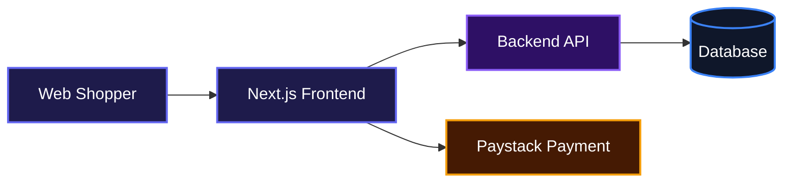
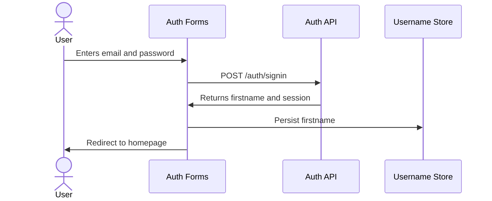
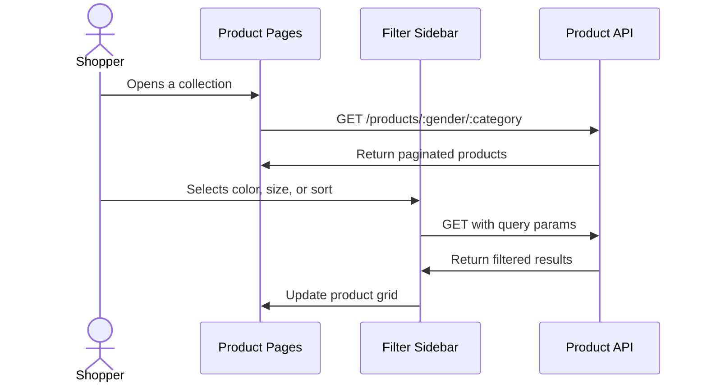
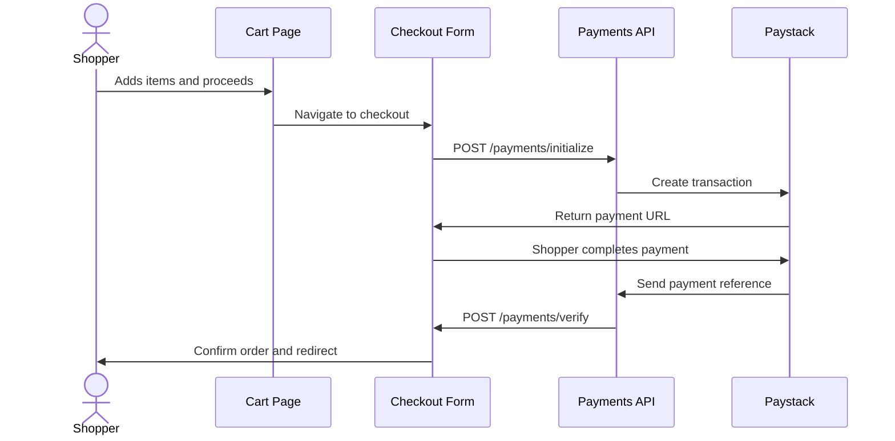

# Celestique

A modern fashion e-commerce storefront built to give shoppers a smooth way to discover, filter, and purchase clothing online. Celestique handles everything from product browsing and search to cart management, secure checkout, and order tracking, so customers can shop with confidence.

## System Architecture



## Features

### Authentication with reCAPTCHA Protection

Users can create accounts or sign in with email and password. Registration includes Google reCAPTCHA validation to reduce spam and bot sign-ups.



### Product Discovery, Filtering, and Search

Shoppers can browse full collections, narrow products by gender and category, apply color and size filters, sort by price, and search with live debounced suggestions.



### Shopping Cart and Checkout

The cart updates in real time, supports quantity changes and item removal, and blocks checkout if any item is out of stock. Checkout collects a Nigerian shipping address and processes payment through Paystack.



### Order History and Wishlist

Signed-in customers can view past orders with full item, payment, and delivery details. They can also save products to a wishlist for later.

## Installation

1. Clone the repository:

```bash
git clone https://github.com/NumCodes/Testing.git
cd testing
```

2. Install dependencies:

```bash
npm install
```

3. Create a local environment file:

```bash
cp .env.local.example .env.local
```

4. Add the required environment variables to `.env.local`:

```env
NEXT_PUBLIC_RECAPTCHA_SITE_KEY=your_recaptcha_site_key
```

You will also need to point the project to your backend API base URL wherever your axios instance is configured.

5. Start the development server:

```bash
npm run dev
```

6. Open your browser and visit `http://localhost:3000`.

## Usage

Once the app is running, you can:

- Browse the homepage with featured product sets and promotional video banners.
- Click on "Men" or "Women" in the navigation to explore collections.
- Use the search page to find products with live suggestions.
- Open a product page to select size, color, and quantity, then add to cart.
- Review your cart, update quantities, remove items, and proceed to checkout.
- Enter your shipping details and pay securely through Paystack.
- View your order history and wishlist from the account dropdown.

Example local dev command:

```bash
npm run dev
```

Example build command for production:

```bash
npm run build
```

## API Documentation

The frontend communicates with a backend API. All endpoints below are called through the axios instance in `services/`.

### Authentication

#### POST /auth/signin

**Description**: Logs in an existing user with email and password.

**Request**:

```json
{
  "email": "user@example.com",
  "password": "securePassword123"
}
```

**Response**:

```json
{
  "message": "Login successful",
  "firstname": "John"
}
```

**Errors**:
- 400: Invalid email or password format
- 401: Incorrect credentials
- 500: Server error

#### POST /auth/signup

**Description**: Registers a new user with reCAPTCHA verification.

**Request**:

```json
{
  "firstname": "John",
  "lastname": "Doe",
  "phoneNumber": "08012345678",
  "email": "user@example.com",
  "password": "securePassword123",
  "recaptchaToken": "recaptcha_token_string"
}
```

**Response**:

```json
{
  "message": "Account created successfully",
  "firstname": "John"
}
```

**Errors**:
- 400: Validation failed or reCAPTCHA not completed
- 409: Email already registered
- 500: Server error

#### POST /auth/logout

**Description**: Logs out the current user and clears the session.

**Request**: No body required.

**Response**:

```json
{
  "message": "Logged out successfully"
}
```

### Products

#### GET /products

**Description**: Fetches all products with pagination.

**Query Parameters**:
- `page` (number): Page number

**Response**:

```json
{
  "products": [...],
  "totalPages": 10
}
```

#### GET /products/:gender/all

**Description**: Fetches all products for a specific gender.

**Response**:

```json
{
  "products": [...],
  "totalPages": 5
}
```

#### GET /products/:gender/:category

**Description**: Fetches products filtered by gender and category.

**Response**:

```json
{
  "products": [...],
  "totalPages": 3
}
```

#### GET /products/:slug

**Description**: Fetches detailed information for a single product by slug.

**Response**:

```json
{
  "product": {
    "_id": "...",
    "name": "Classic White Shirt",
    "price": 15000,
    "quantity": 20,
    "colors": ["White", "Blue"],
    "sizes": ["S", "M", "L"],
    "description": "...",
    "slug": "classic-white-shirt",
    "images": ["..."],
    "category": "shirts",
    "gender": { "gender": "men" }
  }
}
```

#### GET /products/search

**Description**: Searches products by query string.

**Query Parameters**:
- `query` (string): Search term
- `page` (number): Page number

**Response**:

```json
{
  "products": [...],
  "totalPages": 2
}
```

### Cart

#### POST /cart/add

**Description**: Adds a product to the cart.

**Request**:

```json
{
  "productId": "product_id",
  "quantity": 2,
  "size": "M",
  "color": "Black"
}
```

**Response**:

```json
{
  "message": "Item added to cart",
  "cart": { ... }
}
```

#### GET /cart

**Description**: Retrieves the current user's cart.

**Response**:

```json
{
  "cart": {
    "items": [...],
    "subtotal": 30000,
    "deliveryFee": 1500,
    "totalPrice": 31500
  }
}
```

#### PUT /cart/item/:productId

**Description**: Updates the quantity of a cart item.

**Query Parameters**:
- `size` (string)
- `color` (string)
- `quantity` (number)

**Response**:

```json
{
  "message": "Cart updated",
  "cart": { ... }
}
```

#### DELETE /cart/item/:productId

**Description**: Removes a specific item from the cart.

**Query Parameters**:
- `size` (string)
- `color` (string)

**Response**:

```json
{
  "message": "Item removed from cart",
  "cart": { ... }
}
```

#### DELETE /cart/clear

**Description**: Clears all items from the cart.

**Response**:

```json
{
  "message": "Cart cleared",
  "cart": { ... }
}
```

### Payments

#### POST /payments/initialize

**Description**: Initializes a Paystack payment transaction.

**Request**:

```json
{
  "amount": 31500,
  "shippingAddress": {
    "firstName": "John",
    "lastName": "Doe",
    "phoneNumber": "08012345678",
    "address": "123 Main Street",
    "city": "Lagos",
    "state": "Lagos",
    "postalCode": "100001",
    "country": "Nigeria"
  }
}
```

**Response**:

```json
{
  "data": {
    "authorization_url": "https://checkout.paystack.com/..."
  }
}
```

#### POST /payments/verify

**Description**: Verifies a payment after the customer returns from Paystack.

**Request**:

```json
{
  "reference": "paystack_reference",
  "totalAmount": 31500
}
```

**Response**:

```json
{
  "success": true,
  "cart": { ... }
}
```

### Orders

#### GET /orders

**Description**: Fetches the signed-in user's order history.

**Response**:

```json
{
  "orders": [...]
}
```

#### GET /orders/:orderId

**Description**: Fetches detailed information for a specific order.

**Response**:

```json
{
  "orders": {
    "_id": "...",
    "items": [...],
    "totalAmount": 31500,
    "orderStatus": "Processing",
    "paymentId": { "paymentMethod": "Paystack" },
    "shippingAddress": { ... },
    "createdAt": "2024-01-01T00:00:00.000Z"
  }
}
```

### Favorite Products

#### GET /favorite-products

**Description**: Fetches the user's saved wishlist items.

**Response**:

```json
{
  "favoriteProducts": {
    "savedItems": [...]
  }
}
```

#### POST /favorite-products/:id/save

**Description**: Saves or toggles a product in the user's wishlist.

**Response**:

```json
{
  "message": "Product saved to favorites"
}
```

### Environment Variables

| Variable | Description |
|---|---|
| `NEXT_PUBLIC_RECAPTCHA_SITE_KEY` | Google reCAPTCHA site key for registration validation |
| Backend API base URL | Configured in your axios instance to reach the backend server |

## Technologies Used

| Technology | Description |
|---|---|
| [TypeScript](https://www.typescriptlang.org/) | Typed JavaScript for safer code |
| [Next.js](https://nextjs.org/) | React framework for production apps |
| [React](https://react.dev/) | UI library for building interactive interfaces |
| [Tailwind CSS](https://tailwindcss.com/) | Utility-first CSS framework |
| [shadcn/ui](https://ui.shadcn.com/) | Accessible, reusable UI components |
| [Zustand](https://github.com/pmndrs/zustand) | Lightweight state management |
| [React Hook Form](https://react-hook-form.com/) | Performant form handling |
| [Zod](https://zod.dev/) | Schema validation |
| [Paystack](https://paystack.com/) | Payment processing |
| [Axios](https://axios-http.com/) | HTTP client for API requests |

## Contributing

Contributions are welcome. If you would like to improve Celestique, please fork the repository, create a feature branch, and open a pull request with a clear description of your changes.

## Author

- LinkedIn: [Ugochukwu Nweze](https://linkedin.com/in/ugochukwu-nweze-08812a2b8)
- X: [@CodesNum80638](https://x.com/CodesNum80638)

## Badges

[](https://www.typescriptlang.org/)
[](https://nextjs.org/)
[](https://react.dev/)
[](https://tailwindcss.com/)
[](https://github.com/pmndrs/zustand)
[](https://paystack.com/)
[](https://ui.shadcn.com/)
